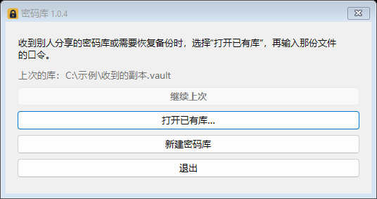

# 密码库 1.0.4（免费源码）

一个 Windows 本地密码库。密码库文件由主密码加密，程序不需要注册账号或联网。本仓库以历史 **1.0.0 的基础功能**为底，加上打开已有库的图形入口和新版字段保留；完整版另行发行，本仓库不包含按人分身或商业授权实现。


## 免费版能做什么

- 新建本地 `.vault` 库，新增、编辑、删除和搜索密码条目；条目包含标题、分类、用户名、密码、网址、备注和多行附加内容。
- 生成随机密码，复制用户名或密码；改主密码，手动或闲置后锁定。
- 导出 JSON 或 CSV，保存前自动保留加密库备份。
- 每次启动可选“继续上次”“打开已有库…”或“新建密码库”。收到别人给的副本或恢复备份时，选择文件，再输入那份文件的口令即可；接收者无需购买授权。也可使用 `密码库.exe .\已有库.vault` 启动参数。
- 打开当前完整版的兼容分享副本后，可以查看、复制和编辑普通字段；保存会保留免费版尚不认识的附加字段。分享副本是快照，发送者以后改动不会自动同步。
- 新建库不会覆盖已有库文件；选错文件可取消并重新选择。

**免费版不提供**浏览器密码批量导入、按人分身创建或同步、浏览器自动填充、移动端。JSON/CSV 导出文件是**明文**，不要当作加密备份转发或长期散放。备份请复制加密 `.vault` 文件，并另行保管口令。忘记主密码，作者也无法恢复库内容。



此免费版保留历史锁定交互：闲置超时后可能弹出密码窗口并影响其他窗口操作。当前完整版已修复；这次免费更新只增加打开入口与兼容保护，未移植锁定交互修复。

## 编译与自检

需要 Windows 和 .NET 10 SDK。源码不依赖第三方 NuGet 包：

```powershell
dotnet build 密码库.slnx
dotnet run --project src\Vault.SelfTest
```

在 Windows x64 上制作自包含单文件程序：

```powershell
dotnet publish src\Vault.App\Vault.App.csproj -c Release -r win-x64 --self-contained true -p:PublishSingleFile=true -p:DebugType=None -o publish\自包含
```

免费 Windows x64 ZIP：[下载密码库 1.0.4](https://download.doradreamland.com/mimaku_1.0.4_win-x64.zip)。[1.0.4 源码 ZIP](https://download.doradreamland.com/mimaku_1.0.4_source.zip)另附。原始 [1.0.0 程序](https://download.doradreamland.com/mimaku_1.0.0_win-x64.zip)和[源码](https://download.doradreamland.com/mimaku_1.0.0_source.zip)仍保留。如果通过别人转发的 ZIP 获取程序，请先核对发行包中的程序哈希。本项目目前没有代码签名证书或独立第三方安全审计；已完成合成数据的启动选择与分享副本界面检查，普通用户环境的完整人工验收仍待补充。

## 文件与许可

`src/Vault.Core` 负责加密和文件读写，`src/Vault.App` 是 WinForms 界面，`src/Vault.SelfTest` 是离线自检。截图只含合成示例。这里发布的源码按 [GPL-3.0-or-later](LICENSE) 提供；其他版本独有的代码不在本仓库中。
