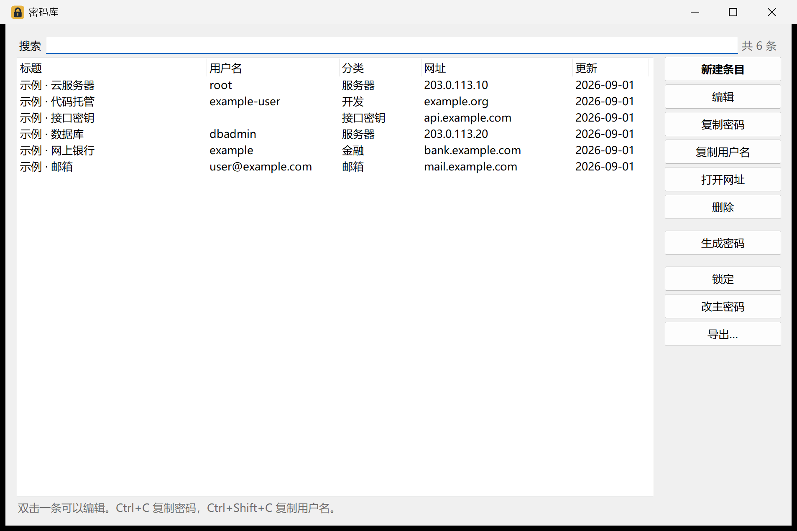

# 密码库 1.0.0（免费源码）

一个 Windows 本地密码库。密码库文件由主密码加密，程序不需要注册账号或联网。本仓库是历史 **1.0.0 的功能代码**及其公开说明；完整版另行发行，本仓库不包含按人分身或商业授权实现。



## 1.0.0 能做什么

- 新建本地 `.vault` 库，新增、编辑、删除和搜索密码条目；条目包含标题、分类、用户名、密码、网址、备注和多行附加内容。
- 生成随机密码，复制用户名或密码；改主密码，手动或闲置后锁定。
- 导出 JSON 或 CSV，保存前自动保留加密库备份。
- 使用启动参数指定已有库文件，例如 `密码库.exe .\已有库.vault`。1.0.0 尚无“打开已有库”的图形界面入口。

**1.0.0 不提供**浏览器密码批量导入、按人分身或同步、浏览器自动填充、移动端。JSON/CSV 导出文件是**明文**，不要当作加密备份转发或长期散放。忘记主密码，作者也无法恢复库内容。

此版本保留历史锁定交互：闲置超时后可能弹出密码窗口并影响其他窗口操作。该问题在后续版本已修复，1.0.0 原始功能代码尚未移植修复；正式分发前需决定是否发布修复版。

## 编译与自检

需要 Windows 和 .NET 10 SDK。源码不依赖第三方 NuGet 包：

```powershell
dotnet build 密码库.slnx
dotnet run --project src\Vault.SelfTest
```

在 Windows x64 上制作自包含单文件程序：

```powershell
dotnet publish src\Vault.App\Vault.App.csproj -c Release -r win-x64 --self-contained true -p:PublishSingleFile=true -p:DebugType=None -o publish\自包含
```

公开下载地址和已签名发行物尚未公布。若要使用第三方发来的 EXE，请核对随正式发行页提供的 SHA-256；本项目目前没有代码签名证书，也未经过独立第三方安全审计。

## 文件与许可

`src/Vault.Core` 负责加密和文件读写，`src/Vault.App` 是 WinForms 界面，`src/Vault.SelfTest` 是离线自检。两张截图只含合成示例。这里发布的源码按 [GPL-3.0-or-later](LICENSE) 提供；其他版本独有的代码不在本仓库中。
